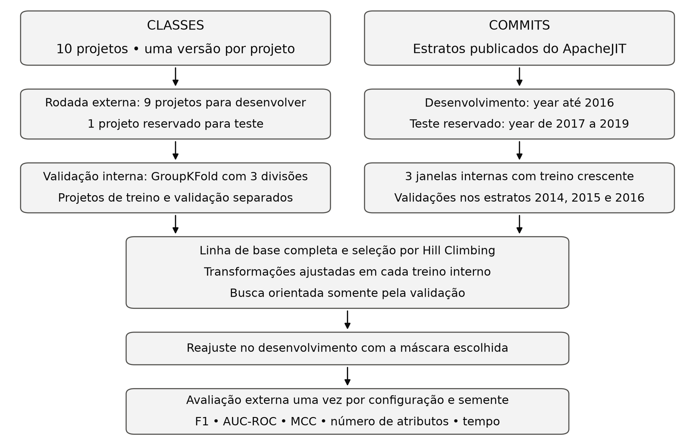

<div align="center">

# Pacote de reprodução do TCC

**Seleção de atributos por Hill Climbing na predição de defeitos de software, nos níveis de classe e de commit**

[](https://doi.org/10.5281/zenodo.24295861)
[](https://github.com/lucasrbsouza/tcc-selecao-atributos-predicao-defeitos/releases)
[](#instalação)
[](LICENSE)

[Visão geral](#visão-geral-do-experimento) ·
[Instalação](#instalação) ·
[Como reproduzir](#como-reproduzir) ·
[Estrutura](#estrutura) ·
[Dados](#dados) ·
[Como citar](#como-citar) ·
[Licença](#licença)

</div>

Pacote de reprodução do TCC de José Lucas Silva Souza (iCEV, Teresina, 2026), com orientação do
Prof. Me. Mauro José Araújo de Melo. Aqui estão o código do experimento e das análises, o manifesto dos dados,
as partições, o registro de cada busca, as previsões e as tabelas de resultados. O desenho do estudo, os resultados
e a discussão estão no texto do TCC; este arquivo trata da organização do pacote e de como reproduzir a execução.

## Visão geral do experimento

<p align="center">
  
  <br>
  <sub>Fluxo do protocolo (Figura 1 do artigo), gerado por <code>figures.py</code>.</sub>
</p>

- **Cenários:** classes de 10 projetos Java (coleção de Jureczko e Madeyski), com um projeto reservado para o teste
  em cada rodada (leave-one-project-out), e 106.674 commits do ApacheJIT, com desenvolvimento até 2016 e teste de
  2017 a 2019.
- **Classificadores:** regressão logística (LR), floresta aleatória (RF) e SVM linear (SVM), cada um treinado com o
  conjunto completo de atributos e com o subconjunto devolvido pela busca.
- **Busca:** Hill Climbing, com o MCC médio de três validações internas como critério; o teste externo não participa
  de nenhuma escolha. Ao todo, 165 buscas (5 sementes) e 330 avaliações externas.
- **Análises a posteriori:** (f) refaz, sem limite de orçamento, as 150 buscas do cenário de classes e foi registrada
  em [`REGISTRO_ANALISE_F.md`](REGISTRO_ANALISE_F.md) antes da execução; (g) refaz o cenário de commits sem o
  identificador `apache/hadoop` e está descrita em [`ANALISE_G.md`](ANALISE_G.md).

As tabelas usadas no texto estão em [`results/analysis/`](results/analysis), e as figuras, em
[`results/figures/`](results/figures).

## Instalação

Requer Linux e Python 3.12 ou 3.13 (os scripts de execução leem `/proc/cpuinfo` para registrar o ambiente).

```bash
git clone https://github.com/lucasrbsouza/tcc-selecao-atributos-predicao-defeitos.git
cd tcc-selecao-atributos-predicao-defeitos
python3.13 -m venv .venv          # ou python3.12
source .venv/bin/activate
pip install -r requirements.txt
python download_data.py           # baixa os dados (cerca de 21 MB) em data/ e confere os hashes
```

## Como reproduzir

Os resultados da execução original já estão em `results/`. A partir deles, é possível refazer só as análises,
refazer parte das buscas para conferi-las ou repetir a execução inteira.

### Refazer as tabelas e as figuras

As análises usam os registros gravados em `results/`, sem repetir as buscas, e terminam em menos de um minuto:

```bash
python analyze.py
python figures.py
python analyze_alternatives.py
python analyze_posthoc.py
python analyze_convergence.py
python analyze_nohadoop.py
```

### Conferir parte da execução

Os scripts `run_*.py` aceitam `--out`, que grava a execução em outra pasta. O `run_experiment.py` aceita também
`--scenario`, `--model`, `--seed` e `--fold` (o projeto de teste, como `ant`, no cenário de classes; `temporal`, no de
commits), para rodar só parte das tarefas. Com isso, é possível refazer uma tarefa, em menos de um minuto, e
compará-la com a execução original:

```bash
python run_experiment.py --out /tmp/reexecucao --scenario classes --fold ant --model LR --seed 101 --workers 1
python compare_tasks.py results /tmp/reexecucao
```

O `compare_tasks.py` compara, tarefa por tarefa, o JSON (exceto os tempos) e as previsões, e termina com código 1 se
houver alguma diferença. A reexecução da análise (g) foi conferida da mesma forma
([`results/nohadoop/conferencia/comparacao.txt`](results/nohadoop/conferencia/comparacao.txt)).

### Execução completa

```bash
# Experimento principal (cerca de 12 horas de CPU)
python run_experiment.py --workers 2
python analyze.py
python figures.py

# Experimento complementar: filtro F e seleção L1 (cerca de 1 hora)
python run_alternatives.py --workers 2
python analyze_alternatives.py

# Análises a posteriori
python analyze_posthoc.py
python run_convergence.py --workers 2   # (f), cerca de 3 horas
python analyze_convergence.py
python run_nohadoop.py --workers 2      # (g), cerca de 2 horas
python analyze_nohadoop.py
```

Cada script `run_*.py` grava um JSON por tarefa e um cache por avaliação e pula as tarefas já gravadas, de modo que a
execução pode ser interrompida e retomada. Com os resultados originais no lugar, não há tarefas a executar; para
recalcular tudo do zero, apague `results/tasks/` e `results/eval_cache/` antes de rodar `run_experiment.py`. Os
tempos indicados são aproximados e se referem a dois processos (`--workers 2`); sem essa opção, os scripts usam um
processo por CPU lógica.

## Estrutura

### Código

| Arquivo | Função |
|---|---|
| [`run_experiment.py`](run_experiment.py) | Experimento completo. Grava um JSON por tarefa e um cache por avaliação; pode ser interrompido e retomado. |
| [`analyze.py`](analyze.py) | Análise das questões de pesquisa: QP1, QP2 (Wilcoxon pareado e Holm) e QP3, além da análise de sensibilidade. |
| [`figures.py`](figures.py) | Figuras do artigo (Figura 1, fluxo do protocolo; Figuras 2 e 3, resultados). |
| [`run_alternatives.py`](run_alternatives.py) | Experimento complementar: filtro univariado (teste F) e seleção embutida (regressão logística L1), sob o mesmo protocolo. |
| [`analyze_alternatives.py`](analyze_alternatives.py) | Comparação entre Hill Climbing, filtro e L1. |
| [`analyze_posthoc.py`](analyze_posthoc.py) | Análises a posteriori feitas só com os registros gravados: trajetórias e paradas por orçamento, origem da máscara escolhida, ganho interno, Wilcoxon bilateral, estimativa de Hodges-Lehmann com intervalo de confiança e desempenho dos commits sem `apache/hadoop` (saídas em `results/analysis/posthoc_*.csv`). |
| [`run_convergence.py`](run_convergence.py) | Análise (f): as 150 buscas do cenário de classes sem limite de orçamento (parada apenas em ótimo local). |
| [`analyze_convergence.py`](analyze_convergence.py) | Comparação da análise (f) com a análise principal (saídas em `results/analysis/convergence_*.csv`). |
| [`run_nohadoop.py`](run_nohadoop.py) | Análise (g): o cenário de commits sem o identificador `apache/hadoop`, retirado do desenvolvimento e do teste. |
| [`analyze_nohadoop.py`](analyze_nohadoop.py) | Comparação da análise (g) com a análise principal e com o recálculo (c) (saídas em `results/analysis/nohadoop_*.csv`). |
| [`compare_tasks.py`](compare_tasks.py) | Compara duas execuções tarefa por tarefa (JSON, exceto tempos, e previsões). |
| [`download_data.py`](download_data.py), [`data_manifest.json`](data_manifest.json) | Obtenção dos dados nas fontes originais, com conferência de SHA-256. |

### Documentos

| Arquivo | Conteúdo |
|---|---|
| [`REGISTRO_ANALISE_F.md`](REGISTRO_ANALISE_F.md) | Registro da análise a posteriori (f), feito antes da execução, e o relato da execução. |
| [`ANALISE_G.md`](ANALISE_G.md) | Descrição da análise a posteriori (g), com o histórico da execução e a conferência. |

### Resultados

| Caminho | Conteúdo |
|---|---|
| [`results/tasks/`](results/tasks) | Um JSON por (cenário, rodada, modelo, semente): subconjunto escolhido, trajetórias, rastro da busca e métricas externas. |
| [`results/eval_cache/`](results/eval_cache) | Cada avaliação de candidato: MCC em cada divisão interna e tempo. |
| [`results/predictions/`](results/predictions) | Previsões e escores no teste externo, com e sem seleção. |
| [`results/analysis/`](results/analysis) | Tabelas usadas no artigo. |
| [`results/figures/`](results/figures) | Figuras. |
| [`results/partitions.csv`](results/partitions.csv) | Partições internas e externas. |
| [`results/environment.json`](results/environment.json), [`results/run.log`](results/run.log) | Ambiente e registro da execução. |
| [`results/alternatives/`](results/alternatives) | Resultados do experimento complementar (tarefas, cache das avaliações e análise). |
| [`results/convergence/`](results/convergence) | Resultados da análise (f): tarefas, cache das avaliações e previsões. |
| [`results/nohadoop/`](results/nohadoop) | Resultados da análise (g): tarefas, cache das avaliações e previsões; em `conferencia/`, o ambiente e a comparação da reexecução. |

## Dados

Os arquivos de dados **não** são redistribuídos aqui; `download_data.py` os obtém das fontes e os grava em `data/`:

- Classes: coleção de Jureczko e Madeyski, pelo espelho [klainfo/DefectData](https://github.com/klainfo/DefectData)
  (revisão fixada no manifesto).
- Commits: ApacheJIT v2 (Keshavarz e Nagappan, 2022; [Zenodo 5907847](https://zenodo.org/records/5907847)), pelo
  repositório dos autores [hosseinkshvrz/apachejit](https://github.com/hosseinkshvrz/apachejit). Os arquivos são
  idênticos, por SHA-256, aos do pacote do Zenodo.

Ao usar os dados, cite os autores originais:

- JURECZKO, M.; MADEYSKI, L. Towards identifying software project clusters with regard to defect prediction. PROMISE 2010.
- KESHAVARZ, H.; NAGAPPAN, M. ApacheJIT: a large dataset for just-in-time defect prediction. MSR 2022.

## Como citar

Versão 1.2.0, usada no artigo: [10.5281/zenodo.24295861](https://doi.org/10.5281/zenodo.24295861).
Para citar sem fixar uma versão, use o DOI conceito [10.5281/zenodo.24258042](https://doi.org/10.5281/zenodo.24258042),
que sempre aponta para a versão mais recente. A página de cada versão no Zenodo traz a referência completa e
permite exportá-la em vários formatos.

| Versão | DOI | Mudanças |
|---|---|---|
| [1.2.0](https://github.com/lucasrbsouza/tcc-selecao-atributos-predicao-defeitos/releases/tag/v1.2.0) | [10.5281/zenodo.24295861](https://doi.org/10.5281/zenodo.24295861) | Acrescentou a análise a posteriori (g). |
| [1.1.0](https://github.com/lucasrbsouza/tcc-selecao-atributos-predicao-defeitos/releases/tag/v1.1.0) | [10.5281/zenodo.24295160](https://doi.org/10.5281/zenodo.24295160) | Acrescentou a análise a posteriori (f). |
| [1.0.0](https://github.com/lucasrbsouza/tcc-selecao-atributos-predicao-defeitos/releases/tag/v1.0.0) | [10.5281/zenodo.24258043](https://doi.org/10.5281/zenodo.24258043) | Primeira versão publicada. |

## Problemas e sugestões

Problemas para reproduzir a execução, erros no código ou na documentação e dúvidas podem ser relatados nas
[issues](https://github.com/lucasrbsouza/tcc-selecao-atributos-predicao-defeitos/issues) do repositório. Ao relatar
um problema, informe o comando usado, a versão do Python e a mensagem de erro.

## Licença

O código deste repositório é distribuído sob a [GNU General Public License v3.0](LICENSE). Copyright (C) 2026
José Lucas Silva Souza. Os dados das bases não fazem parte do repositório e seguem as condições de uso de seus autores.
